

I produce alternate art printings of Netrunner cards! All of my alt arts comply with the [Null Signal Games Organised Play Policies](https://nullsignal.games/organizers/organized-play-policies/) and are manufactured by [Personalised Playing Cards](https://www.personalisedplayingcards.com) in the UK on high quality 330gsm card stock, making them suitable for use in tournaments.

# For Sale
Identity Card: £3.50
Playset: £5.00

## Corp

	

		<a href="https://netrunnerdb.com/en/card/36066" target="_blank">
			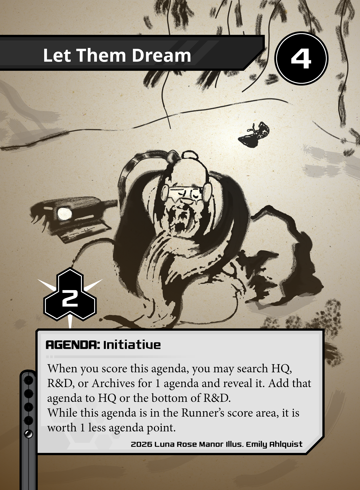
		</a>
	

	

		<a href="https://netrunnerdb.com/en/card/30066" target="_blank">
			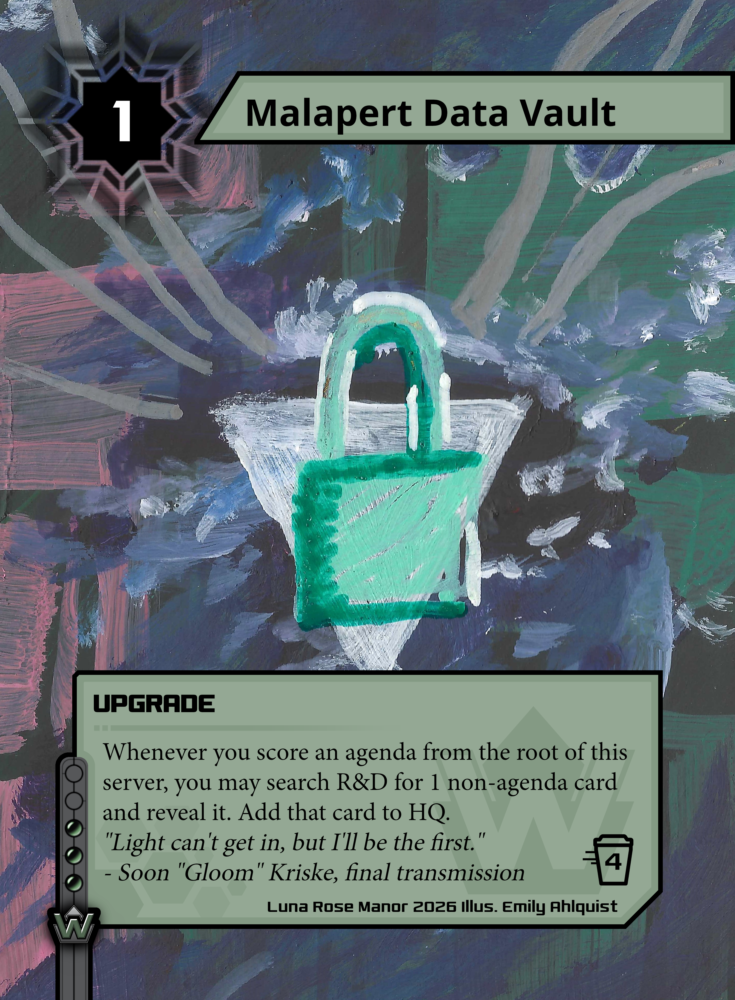
		</a>
	

	

		<a href="https://netrunnerdb.com/en/card/36061" target="_blank">
			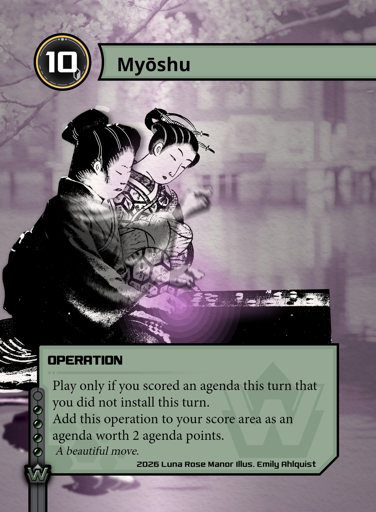
		</a>
	

	

		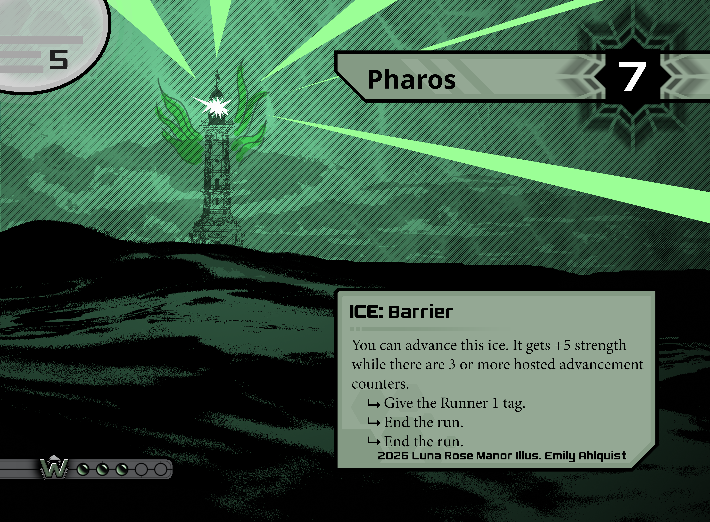
	

	

		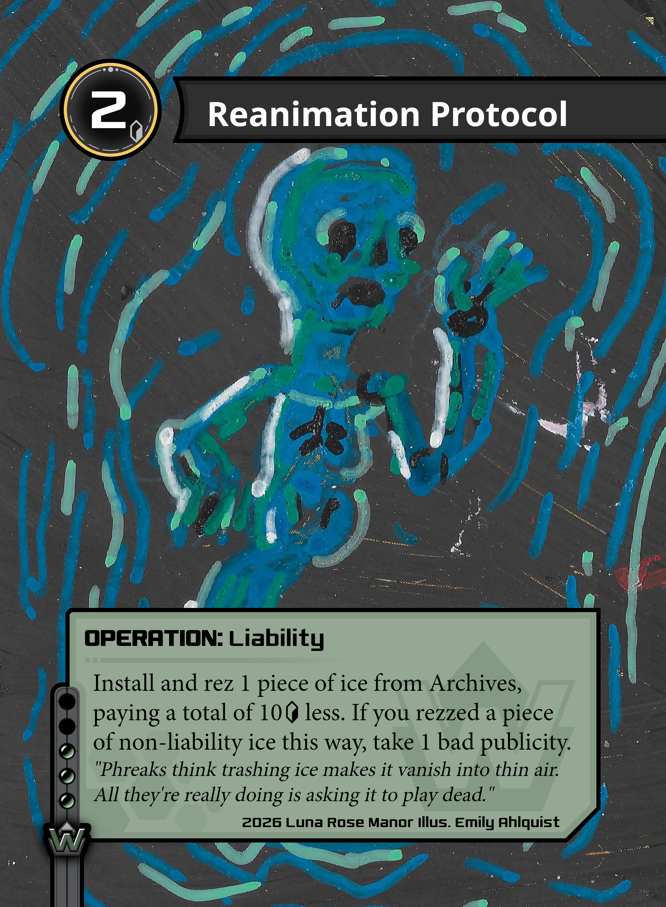
	

	

		
	

	

		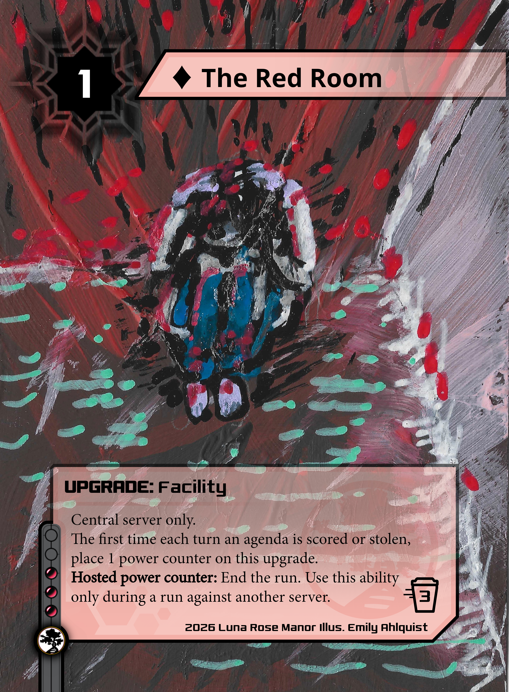
	

	

		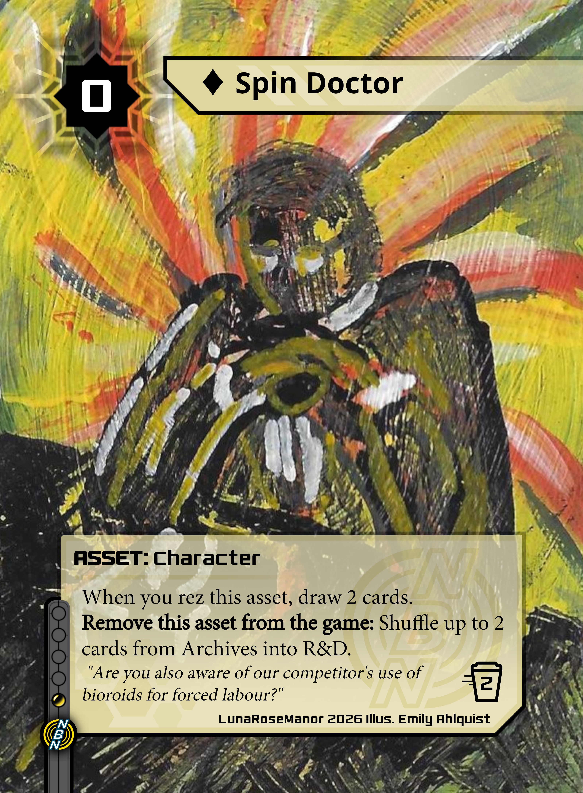
	

	

		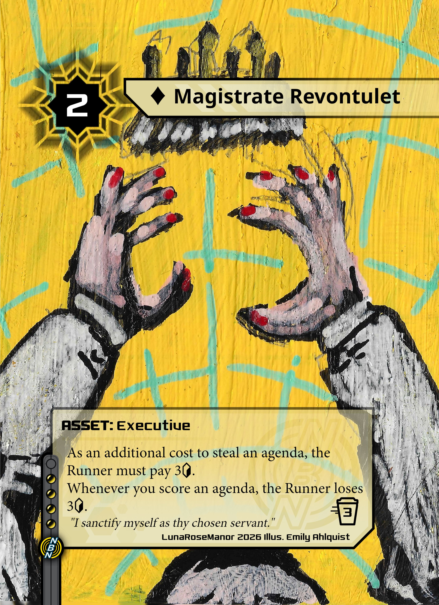
	

## Runner

	

		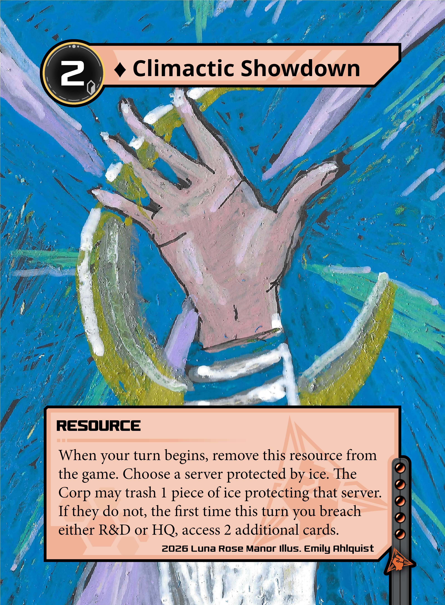
	

	

		
	

	

		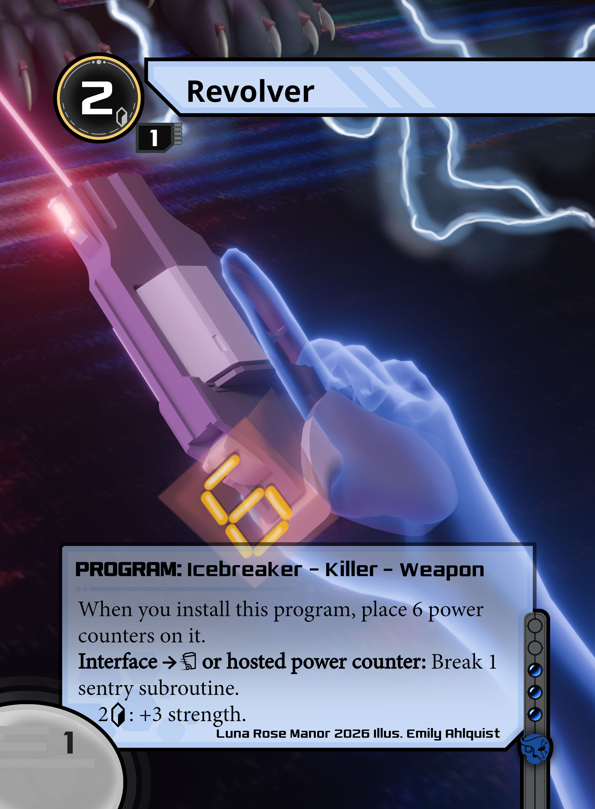
	

	

		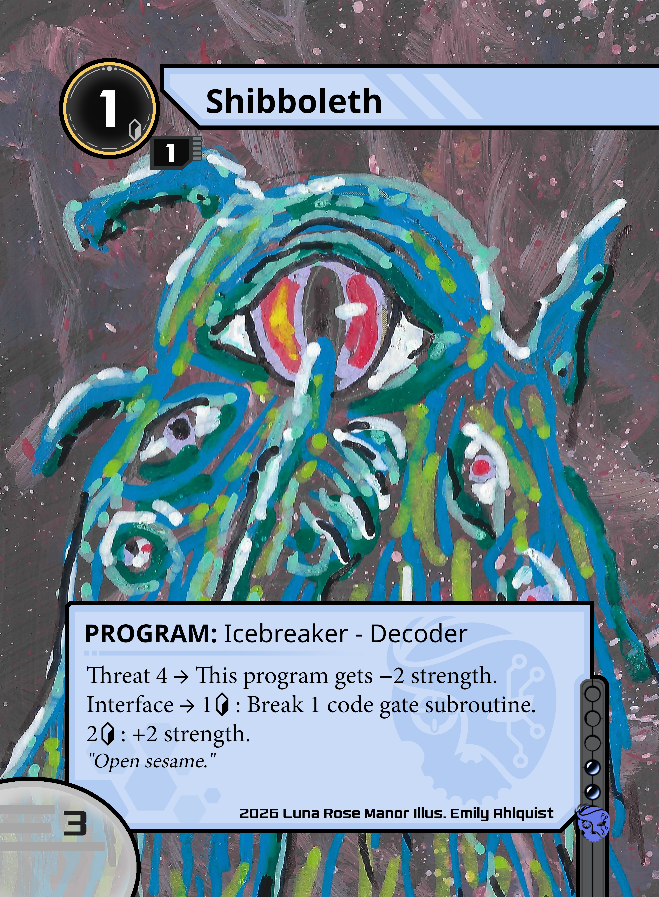
	

	

		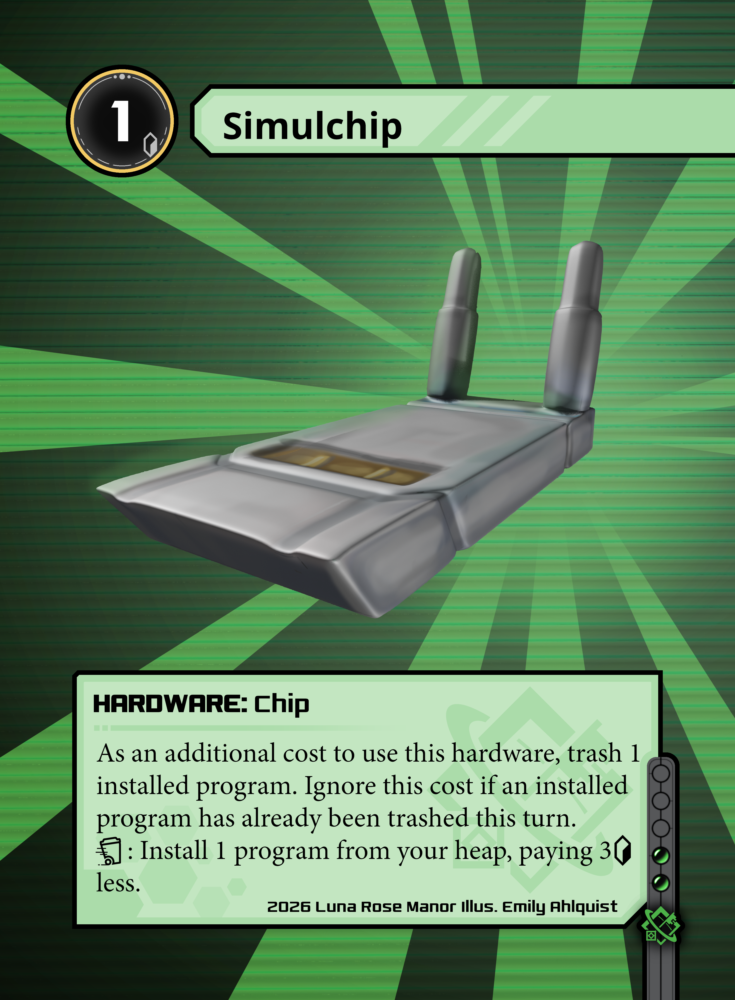
	

	

## Guest Artists
Sometimes I'll commission one of my friends to put their work to sleevable cardboard and distribute it. All artwork here is featured with permission.
### [Nosette](https://bsky.app/profile/nosette.bsky.social)

	

		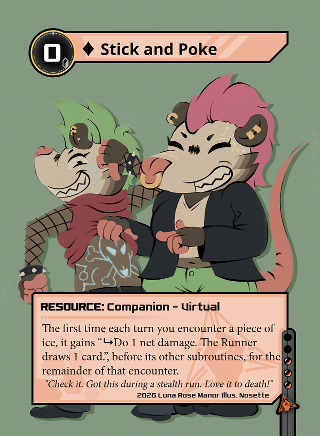
	

	

	

	

# Disclosure
Only the cards featured in the "for sale" section are actively in print. Everything listed here is my own original work unless otherwise stated and I don't use so-called "AI" for any of my illustration or flavour text on moral principle. I work with a mixture of mediums both physical and digital. The software I use most often is Krita, GIMP and Blender, with some middleware to help me scan physical artwork for final compositing. The vast majority of my alt arts use [Ams' Netrunner Frames](https://github.com/distributive/netrunner-card-frames) for better legibility.